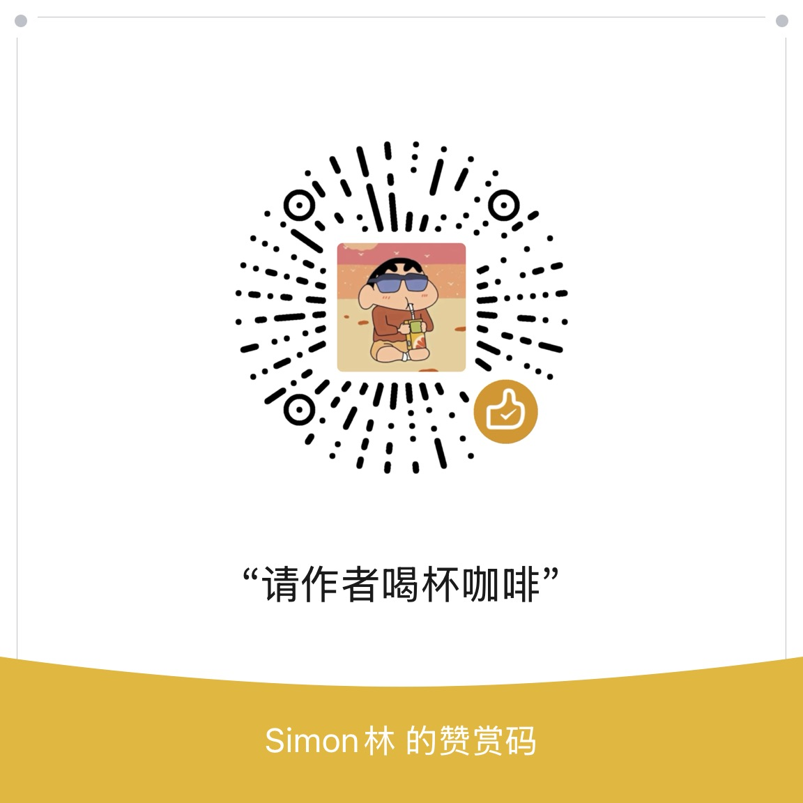

# CEO Talks

**AI 与科技公司领军人物，本人亲口讲的长视频** · 13 位人物 · 播客 / 访谈 / 演讲 / 座谈 · 20 分钟以上 · 中英双语网站 · 不用装任何依赖

<p align="center"></p>

马斯克、黄仁勋、苏姿丰、奥特曼、哈萨比斯……这些人每周都在 YouTube 上出现很多次，但大部分是别人在讲他们：解说、剪辑、搬运、翻译配音。
CEO Talks 每隔一段时间去 YouTube 搜一遍名单上的人，**只留下本人亲自出镜讲的**长视频，攒成一个越来越全的库，再生成一个静态网站：
首屏放最新一期，下面按时间分段，也可以按人切换、只看 24 小时内新的。

整个项目分两半：

- **抓取端**（`fetcher/`）：Python 3.9 自带的库就能跑，不用 `pip install`，不用申请 YouTube key。
- **网站**（`site/`）：纯 HTML + CSS + JS，不用打包，放到任何静态托管上就能用。中文版在 `/`，英文版在 `/en/`，右上角一键切换。

「是不是本人在讲」这一步交给 AI 判断，AI 可以换、也可以关：接任何 OpenAI 兼容接口（OpenAI、DeepSeek、OpenRouter、智谱、本机 Ollama 等），
或者任何本机命令（比如 Claude Code 的 `claude -p`、Codex 的 `codex exec -`）。

---

## 怎么转

```
people.json（名单 + 认名字的规则）
        │
        ▼
① 每人搜两次 YouTube：引号里的全名、全名 + interview；本周上传、20 分钟以上
② 标题或简介里有这个人的名字（或「英伟达 CEO」这类头衔）才算候选
③ AI 判断：是不是本人在讲；顺带给中文标题、一句话简介、去掉同一场的重复      ← 可换、可关
④ 只给要收的打开视频页，拿准确的发布时间和时长
        │
        ▼
data/store.json（累积库，判过的不重判，留 400 天）
        │
        ▼
site/data/leaders.json（页面数据：每人最新 20 条）
        │
        ▼
site/index.html（中文）· site/en/index.html（英文）
```

## 快速开始

需要 Python 3.9 以上，macOS 或 Linux（Windows 请用 WSL，文件锁用的是 Unix 的 `fcntl`）。国内要能上 YouTube（默认走系统的 `HTTPS_PROXY`）。

```bash
git clone https://github.com/simonlin1212/ceotalks.git
cd ceotalks
```

抓一轮（AI 关着，几分钟）：

```bash
python3 -I fetcher/leaders.py
```

第一次想多攒一些，搜今年的：

```bash
python3 -I fetcher/leaders.py --backfill
```

本机打开网站，然后浏览器开 http://127.0.0.1:8860/ （英文版 http://127.0.0.1:8860/en/ ）：

```bash
node dev/serve.mjs 8860
```

没有 Node 也行：

```bash
python3 -I -m http.server 8860 --bind 127.0.0.1 --directory site
```

## AI 判断（建议打开）

不开 AI 时，只有 `people.json` 里认的**公司官方频道**（带认证标）和两个**只请嘉宾来聊的访谈节目**上的视频会放上页面，标「没判」，
内容会少很多。实测从空库抓一轮：13 个人搜到 142 条候选，AI 关着只有 2 条上了页面（都是黄仁勋在 NVIDIA 官方频道的），其他人一条都没有。

AI 判过的视频存在库里，以后不再判；每一轮只把新出现的候选交给 AI，所以花不了多少 token。

设置方法：把 `config.example.env` 拷一份叫 `config.env`（不进仓库），改好后 `source config.env` 再跑。

| `LEADERS_AI` | 用什么 | 要设的 |
|---|---|---|
| `off`（默认） | 不叫 AI | — |
| `openai` | 任何 OpenAI 兼容的聊天接口 | `LEADERS_AI_URL`（默认 OpenAI 官方）、`LEADERS_AI_MODEL`、key 放 `LEADERS_AI_KEY` 或写进文件用 `LEADERS_AI_KEY_FILE` 指过去；本机模型可以不要 key |
| `command` | 任何「从标准输入读提示词、往标准输出写回答」的命令 | `LEADERS_AI_CMD`，例如 `codex exec --skip-git-repo-check -s read-only -` |

例子：用本机 Codex 命令行跑一轮

```bash
LEADERS_AI=command LEADERS_AI_CMD="codex exec --skip-git-repo-check -s read-only -" LEADERS_AI_TIMEOUT=300 python3 -I fetcher/leaders.py
```

key 只从环境变量或 key 文件现读，不写进代码、日志和输出；出错信息里的 key 会先抹掉。

**换 AI 之前先对一下**：`check_ai.py` 从库里挑判过的视频（收、不收各一半），让现在设的 AI 重判一遍，看跟库里的判法一不一样，只读不改库。

```bash
python3 -I fetcher/check_ai.py --n 16
```

## 名单

名单和认名字的规则都在 `fetcher/people.json`，加人、删人只改它，不用改代码：

| 字段 | 意思 |
|---|---|
| `key` | 网址里用的名字，如 `#who=jensen` |
| `zh` / `en` | 中文名 / 英文名 |
| `role` / `role_en` | 网站中文版、英文版显示的头衔 |
| `names` | 标题里出现就算这个人（全名、姓） |
| `titles` | 头衔也算（如 `Nvidia CEO`） |
| `short` + `short_ctx` | 只有名、没有姓的叫法，还得同时出现 `short_ctx` 里的词才算 |
| `same_surname` | 同姓的家人、同事，只有姓又带这些名字的不算 |

另外两张表：`official_channels`（认的公司官方频道名）、`interview_channels`（认的访谈节目，按频道编号认，因为显示名谁都能起）。

只改了名字或头衔，不用重新抓，重出页面数据就行（不搜、不叫 AI）：

```bash
python3 -I fetcher/leaders.py --page-only
```

只跑某几个人：`--only jensen,lisasu`。

## 部署上线

网站是纯静态的，`site/` 整个放到任何静态托管上就行（Cloudflare Pages、GitHub Pages、Netlify、自己的服务器）。

要让内容一直更新，在一台能上 YouTube 的机器上定时跑抓取，再把 `site/data/leaders.json` 传上去。比如每 2 小时跑一次的 crontab：

```
25 */2 * * * cd /path/to/ceotalks && . ./config.env && python3 -I fetcher/leaders.py >> data/run.log 2>&1
```

同一时间只会跑一轮（文件锁），上一轮没跑完，这一轮直接跳过。页面上会显示上次更新时间；太久没更新会标出来。

数据和页面的位置可以改：`LEADERS_DATA`（累积库，默认 `data/`）、`LEADERS_OUT`（页面数据，默认 `site/data/leaders.json`）、`LEADERS_PEOPLE`（名单）。

## 页面数据格式

`site/data/leaders.json` 也可以拿去接你自己的前端：

```jsonc
{
  "meta": { "built": "2026-10-27T15:22:10Z", "ai": true, "aiProvider": "command", "errors": [], "rule": "…" },
  "people": [{
    "key": "jensen", "zh": "黄仁勋", "en": "Jensen Huang", "role": "英伟达 CEO", "role_en": "NVIDIA CEO",
    "videos": [{
      "id": "v-NGxyPjcrE", "url": "https://www.youtube.com/watch?v=v-NGxyPjcrE",
      "title": "NVIDIA GTC Berlin 2026 Keynote With CEO Jensen Huang",
      "zh": "英伟达 GTC 柏林 2026 主题演讲（CEO 黄仁勋）", "gist": "一句话简介",
      "kind": "演讲", "channel": "NVIDIA", "published": "2026-10-23T08:43:07Z", "approx": false,
      "duration": 5519, "views": 18910335, "judged": true
    }]
  }]
}
```

- `approx: true`：发布时间是搜索页给的大约时间（「5 小时前」这种），还没打开视频页核准。
- `judged: false`：AI 没判过（AI 关着时，认得的频道上的先放上来）。
- `kind`：播客 / 访谈 / 演讲 / 座谈，英文版显示成 Podcast / Interview / Talk / Panel。

## 网站

- 网址记着看什么：`#` 所有人、`#24h` 只看 24 小时内、`#who=jensen` 只看一个人，两样能叠（`#24h&who=jensen`），每个人有自己的链接可以转发。
- 切换中英文时会带着当前看的人一起过去。
- 时间按看的人自己电脑的时区显示。
- 英文版只放 YouTube 原标题，中文版另有 AI 写的中文标题和一句话简介。
- 标志和分享图：改 `brand/make_logo.py` 跑一次出 SVG，再跑 `zsh brand/make_images.sh`（用本机 Chrome 截出分享图和手机图标，macOS 路径）。

## 自测

不联网，13 条：认名字、AI 回话怎么认和去重、两种 AI 接法、key 不出现在报错里、AI 关着时只放哪些、每个人中英文头衔都有。

```bash
python3 -I tests/test_offline.py
```

## FAQ

**Q：跑出来内容很少？**
AI 关着时只放认得的官方频道和访谈节目上的，内容会少很多。打开 AI（见上面），或者第一次跑加 `--backfill`。

**Q：日志里说「没取全」或者「人机验证」？**
YouTube 偶尔不给正常页面，这一轮记成「没取全」，页面上会标出来，下一轮再搜。碰到 429 或人机验证会停掉这一轮，别马上重跑。
一轮最多打开 30 个视频页、每次隔 2 秒，就是为了不被拦。

**Q：能放在 GitHub Actions 之类的云端定时跑吗？**
能跑，但机房的地址更容易被 YouTube 要求人机验证。家里或办公室能上 YouTube 的机器最稳。

**Q：国内跑不通？**
要能上 YouTube。抓取默认照系统的 `HTTPS_PROXY` 走；不想走代理设 `LEADERS_NO_PROXY=1`。

**Q：换一家 AI，判出来会不一样吗？**
会有差别。换之前用 `check_ai.py` 对一批，看看跟库里的判法差多少。

**Q：为什么只收 20 分钟以上的？**
短的大多是剪辑和切片。本人上的播客、访谈、演讲基本都在 20 分钟以上。

## 更新日志

见 [CHANGELOG.md](./CHANGELOG.md)。

## Donate

如果这个项目对你有帮助，欢迎请作者喝杯咖啡 ☕

<p align="center">
  
</p>
<p align="center">
  <a href="https://ifdian.net/a/simonlin">爱发电</a> ·
  <a href="https://buymeacoffee.com/simonlin1212">Buy Me a Coffee</a>
</p>

> 想加人、想要什么功能？欢迎开 [Issue](https://github.com/simonlin1212/ceotalks/issues)，赞助者的 Issue 优先处理。

## Disclaimer

- 本项目与 YouTube、Google 以及名单上的任何人物、公司都没有关联。
- 视频的版权归原作者。网站只展示标题、频道名、缩略图和链接，看视频要去 YouTube。
- 中文标题和一句话简介由 AI 根据原标题和简介生成，可能有误，以原视频为准。
- 抓取读的是 YouTube 的公开页面，请遵守 YouTube 的服务条款，控制抓取频率。
- 网站内容只是整理视频，不构成任何投资建议。

## License

[Apache License 2.0](./LICENSE)

**作者：** Simon · 抖音「Simon林」 · 公众号「硅基世纪」

---

<details>
<summary>🇬🇧 English</summary>

# CEO Talks

**Long-form videos where AI and tech leaders speak for themselves** · 13 leaders · podcasts / interviews / talks / panels · 20 minutes or longer · bilingual website (Chinese / English) · no dependencies to install

Elon Musk, Jensen Huang, Lisa Su, Sam Altman, Demis Hassabis… They show up on YouTube many times a week, but most of those videos are other people talking about them: commentary, clips, reuploads, dubbed translations.
CEO Talks searches YouTube for everyone on the list at regular intervals, **keeps only the long-form videos where the person is actually there speaking**, builds up a growing library, and turns it into a static website:
the newest video up top, everything else grouped by time, with a filter for each person and for the last 24 hours.

The project has two halves:

- **Fetcher** (`fetcher/`): runs on the Python 3.9 standard library. No `pip install`, no YouTube API key.
- **Website** (`site/`): plain HTML + CSS + JS, no build step, works on any static host. Chinese at `/`, English at `/en/`, with a switch in the top right corner.

The "is this really them speaking?" step is done by an AI, which you can swap or turn off: any OpenAI-compatible API (OpenAI, DeepSeek, OpenRouter, Zhipu, a local Ollama, etc.),
or any local command (e.g. Claude Code's `claude -p` or Codex's `codex exec -`).

## How it works

```
people.json (the list + name-matching rules)
        │
        ▼
① Two YouTube searches per person: the full name in quotes, and full name + interview; uploaded this week, 20 minutes or longer
② A video is a candidate only if its title or description mentions the person (or a title like "Nvidia CEO")
③ AI review: is it really them speaking? Also writes a Chinese title, a one-line summary, and removes duplicates of the same event   ← swappable, optional
④ Only videos that pass get their video page opened, for the exact publish time and length
        │
        ▼
data/store.json (growing library; reviewed videos are never re-reviewed; kept for 400 days)
        │
        ▼
site/data/leaders.json (page data: latest 20 per person)
        │
        ▼
site/index.html (Chinese) · site/en/index.html (English)
```

## Quick start

Needs Python 3.9+, on macOS or Linux (on Windows use WSL; the file lock uses Unix `fcntl`). The machine must be able to reach YouTube (it follows the system `HTTPS_PROXY` by default).

```bash
git clone https://github.com/simonlin1212/ceotalks.git
cd ceotalks
```

Run one round (AI off, takes a few minutes):

```bash
python3 -I fetcher/leaders.py
```

To fill the library on the first run, search this year instead of this week:

```bash
python3 -I fetcher/leaders.py --backfill
```

Open the site locally at http://127.0.0.1:8860/ (English: http://127.0.0.1:8860/en/):

```bash
node dev/serve.mjs 8860
```

No Node? This works too:

```bash
python3 -I -m http.server 8860 --bind 127.0.0.1 --directory site
```

## AI review (recommended)

With the AI off, only videos from the **verified official company channels** and the two **guest-only interview shows** listed in `people.json` make it onto the page, marked "Unreviewed",
so there's a lot less content. In our test from an empty library, one round found 142 candidates for 13 people; with the AI off only 2 made it onto the page (both Jensen Huang on NVIDIA's own channel), and nobody else had any.

Reviewed videos are stored in the library and never reviewed again. Each round only sends new candidates to the AI, so it uses very few tokens.

Setup: copy `config.example.env` to `config.env` (not committed), edit it, then `source config.env` before running.

| `LEADERS_AI` | What it uses | Settings |
|---|---|---|
| `off` (default) | No AI | — |
| `openai` | Any OpenAI-compatible chat API | `LEADERS_AI_URL` (defaults to OpenAI), `LEADERS_AI_MODEL`, and the key in `LEADERS_AI_KEY` or in a file pointed to by `LEADERS_AI_KEY_FILE`; local models can skip the key |
| `command` | Any command that reads the prompt on stdin and writes the answer to stdout | `LEADERS_AI_CMD`, e.g. `codex exec --skip-git-repo-check -s read-only -` |

Example: one round with the local Codex CLI

```bash
LEADERS_AI=command LEADERS_AI_CMD="codex exec --skip-git-repo-check -s read-only -" LEADERS_AI_TIMEOUT=300 python3 -I fetcher/leaders.py
```

The key is read from the environment or the key file at run time and never written to code, logs or output; it is scrubbed from error messages.

**Before switching AI providers**, `check_ai.py` picks reviewed videos from the library (half kept, half rejected), has the current AI review them again and shows where it disagrees. It only reads the library.

```bash
python3 -I fetcher/check_ai.py --n 16
```

## The list

The list and the name-matching rules live in `fetcher/people.json`. Add or remove people there; no code changes needed:

| Field | Meaning |
|---|---|
| `key` | Name used in the URL, e.g. `#who=jensen` |
| `zh` / `en` | Chinese / English name |
| `role` / `role_en` | Title shown on the Chinese / English site |
| `names` | Counts as this person if it appears in a title (full name, surname) |
| `titles` | Titles that also count (e.g. `Nvidia CEO`) |
| `short` + `short_ctx` | First-name-only forms; they count only if a word from `short_ctx` also appears |
| `same_surname` | Family members or colleagues with the same surname; a surname plus one of these names doesn't count |

Two more tables: `official_channels` (official company channel names) and `interview_channels` (interview shows, matched by channel ID because anyone can pick a display name).

If you only changed names or titles, rebuild the page data without fetching again (no searches, no AI):

```bash
python3 -I fetcher/leaders.py --page-only
```

To run only some people: `--only jensen,lisasu`.

## Deploying

The website is fully static: put the whole `site/` folder on any static host (Cloudflare Pages, GitHub Pages, Netlify, your own server).

To keep it updated, run the fetcher on a schedule on a machine that can reach YouTube, then upload `site/data/leaders.json`. For example, every 2 hours with crontab:

```
25 */2 * * * cd /path/to/ceotalks && . ./config.env && python3 -I fetcher/leaders.py >> data/run.log 2>&1
```

Only one round runs at a time (file lock); if the previous one is still running, the new one exits. The page shows when it was last updated and flags it if that was a while ago.

Locations can be changed: `LEADERS_DATA` (library, default `data/`), `LEADERS_OUT` (page data, default `site/data/leaders.json`), `LEADERS_PEOPLE` (the list).

## Page data format

You can also feed `site/data/leaders.json` into your own front end:

```jsonc
{
  "meta": { "built": "2026-10-27T15:22:10Z", "ai": true, "aiProvider": "command", "errors": [], "rule": "…" },
  "people": [{
    "key": "jensen", "zh": "黄仁勋", "en": "Jensen Huang", "role": "英伟达 CEO", "role_en": "NVIDIA CEO",
    "videos": [{
      "id": "v-NGxyPjcrE", "url": "https://www.youtube.com/watch?v=v-NGxyPjcrE",
      "title": "NVIDIA GTC Berlin 2026 Keynote With CEO Jensen Huang",
      "zh": "英伟达 GTC 柏林 2026 主题演讲（CEO 黄仁勋）", "gist": "one-line summary",
      "kind": "演讲", "channel": "NVIDIA", "published": "2026-10-23T08:43:07Z", "approx": false,
      "duration": 5519, "views": 18910335, "judged": true
    }]
  }]
}
```

- `approx: true`: the publish time is the rough one from the search page ("5 hours ago"); the video page hasn't been checked yet.
- `judged: false`: not reviewed by AI (with the AI off, videos from known channels go up first).
- `kind`: 播客 / 访谈 / 演讲 / 座谈, shown on the English site as Podcast / Interview / Talk / Panel.

## The website

- The URL remembers what you're looking at: `#` everyone, `#24h` last 24 hours only, `#who=jensen` one person; they combine (`#24h&who=jensen`), so every person has a link you can share.
- Switching language keeps the person you're viewing.
- Times are shown in the visitor's own time zone.
- The English site shows original YouTube titles; the Chinese site adds AI-written Chinese titles and summaries.
- Logo and share images: edit `brand/make_logo.py` and run it to produce the SVGs, then run `zsh brand/make_images.sh` (uses local Chrome to render the share images and the phone icon; macOS path).

## Tests

Offline, 13 tests: name matching, parsing AI replies and deduplication, both AI connectors, keys never appearing in errors, what shows when the AI is off, and every person having both titles.

```bash
python3 -I tests/test_offline.py
```

## Changelog

See [CHANGELOG.md](./CHANGELOG.md).

## Donate

If this project helps you, feel free to buy the author a coffee ☕

<p align="center">
  <a href="https://buymeacoffee.com/simonlin1212">Buy Me a Coffee</a> ·
  <a href="https://ifdian.net/a/simonlin">爱发电 (Afdian)</a>
</p>

> Want someone added, or a feature? Open an [Issue](https://github.com/simonlin1212/ceotalks/issues). Sponsors' issues get priority.

## Disclaimer

- This project is not affiliated with YouTube, Google, or any person or company on the list.
- Videos belong to their creators. The site only shows titles, channel names, thumbnails and links; you watch the videos on YouTube.
- Chinese titles and one-line summaries are written by AI from the original title and description and may contain mistakes; the original video is the reference.
- The fetcher reads public YouTube pages. Please follow YouTube's Terms of Service and keep the request rate low.
- The site only organizes videos and is not investment advice.

## License

[Apache License 2.0](./LICENSE)

**Author:** Simon · TikTok [@simonlin121212](https://www.tiktok.com/@simonlin121212) · Douyin "Simon林" · WeChat Official Account "硅基世纪"

</details>
