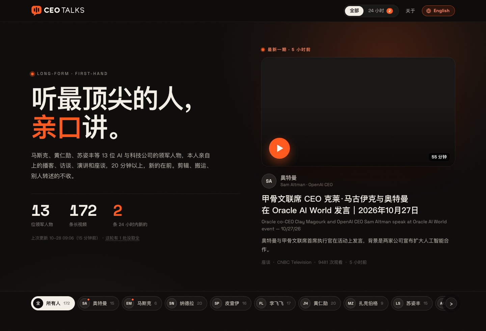
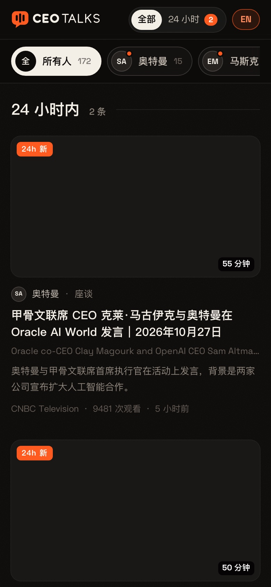
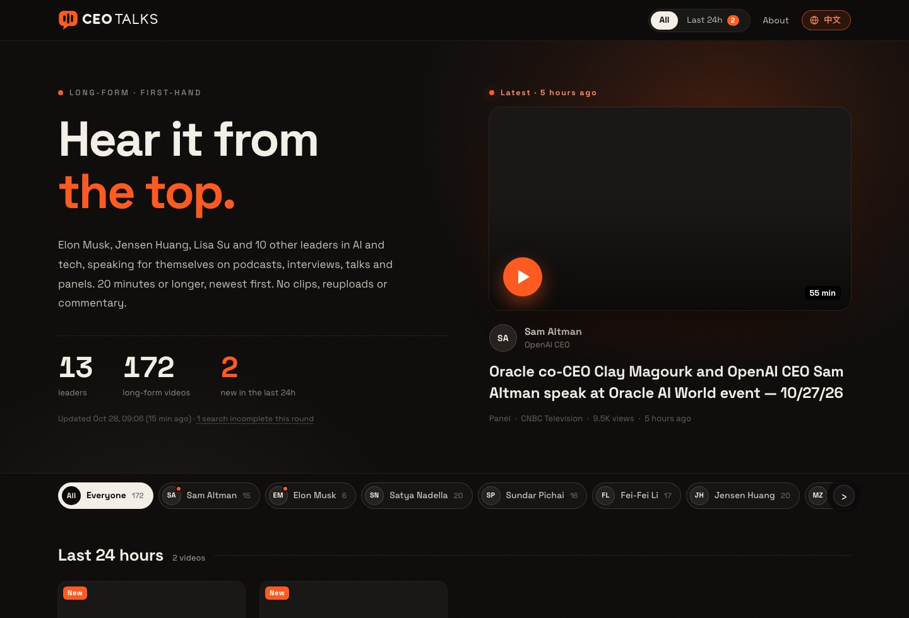

<p align="center"><b>简体中文</b> | <a href="README_en.md">English</a></p>

<h1 align="center">CEO Talks</h1>

<p align="center">
  <b>AI 与科技公司领军人物，本人亲口讲的长视频</b><br>
  13 位人物 · 播客 / 访谈 / 演讲 / 座谈 · 20 分钟以上 · 只收本人出镜 · 中英双语网站 · 不用 YouTube key · 零依赖
</p>

<p align="center">
  <a href="LICENSE"></a>
  <a href="CHANGELOG.md"></a>
  
  
  
  
</p>

---

<p align="center">
  <a href="#网站截图">网站截图</a> ·
  <a href="#收录范围">收录范围</a> ·
  <a href="#快速开始">快速开始</a> ·
  <a href="#ai-判断">AI 判断</a> ·
  <a href="#能力清单">能力清单</a> ·
  <a href="#工作原理">工作原理</a> ·
  <a href="#部署上线">部署上线</a> ·
  <a href="#faq">FAQ</a> ·
  <a href="CHANGELOG.md">更新日志</a>
</p>

<p align="center"></p>

马斯克、黄仁勋、苏姿丰、奥特曼、哈萨比斯……这些人每周都在 YouTube 上出现很多次，但大部分是别人在讲他们：解说、剪辑、搬运、翻译配音。
CEO Talks 定时去 YouTube 搜一遍名单上的人，**只留下本人亲自出镜讲的长视频**，攒成一个越来越全的库，再生成一个中英双语的静态网站：首屏放最新一期，下面按时间分段，可以按人看、只看 24 小时内新的。

- **13 位 AI 与科技公司领军人物**：马斯克、黄仁勋、苏姿丰、陈立武、李飞飞、皮查伊、哈萨比斯、阿莫代伊、奥特曼、扎克伯格、纳德拉、苏茨克维、卡帕西。名单在一个 JSON 文件里，加人删人不改代码。
- **只收本人讲的**：本人上的播客、接受的长访谈、主题演讲、炉边谈话和座谈，20 分钟以上。别人讲这些人的解说、新闻解读、剪辑合集、搬运、AI 配音和翻译配音一律不收。
- **AI 判断可换可关**：接本机的 Claude Code、Codex 命令行，或任何 OpenAI 兼容接口（OpenAI、DeepSeek、OpenRouter、智谱、本机 Ollama 等）；关掉也能跑，只放认得的官方频道和访谈节目。
- **中英双语网站**：中文版在 `/`，有 AI 写的中文标题和一句话简介；英文版在 `/en/`，放 YouTube 原标题。右上角一键切换，切过去还停在同一个人。
- **什么都不用装**：抓取端只用 Python 3.9 自带的库，不用 `pip install`、不用申请 YouTube key；网站是纯 HTML + CSS + JS，不用打包，放到任何静态托管上就能用。
- **越攒越全**：判过的视频存在本机的库里，以后不再判，留 400 天；每一轮只把新出现的候选交给 AI。

> 当前版本 v1.0.0（2026-10-28）：第一个版本。抓取端、中英双语网站、三种 AI 接法，14 条离线自测。

---

## 网站截图

<table>
<tr>
<td width="62%" valign="top"><br><b>中文版首页</b>：一句话说明、三个数、上次更新时间、最新一期大卡片，下面是人名栏和按时间分段的列表</td>
<td width="38%" valign="top"><br><b>手机上看</b>：人名栏横着滑，往下翻也停在顶上</td>
</tr>
<tr>
<td colspan="2"><br><b>英文版</b>：全英文，只放 YouTube 原标题；右上角切回中文</td>
</tr>
</table>

> 截图里的视频封面换成了空白：封面的版权归视频作者，网站上是看的人的浏览器直接从 YouTube 取来显示的，不进这个仓库。

网站上能做的：

- **首屏**：一句话说明这是什么，三个数（几位领军人物 / 几条长视频 / 24 小时内新的几条），上次更新时间，最新一期放大显示。
- **人名栏**：「所有人」加 13 位，往下翻也停在顶上，随时切人；头像上的橙点表示这个人 24 小时内有新的。
- **列表**：看所有人时按「24 小时内 / 最近 7 天 / 最近 30 天 / 更早」分段；点一个人只看这个人的。
- **每一条**：封面和时长、「24h 新」角标、类型（播客 / 访谈 / 演讲 / 座谈）、频道、播放量、多久以前发的；中文版另有中文标题、原标题和一句话简介。AI 没判过的标「没判」。
- **时间**：一个月内写「几分钟前 / 几小时前 / 几天前」，再早的写日期；只拿到大约时间的前面标「约」；鼠标停在准确时间上，显示看的人自己时区的日期和钟点。
- **网址记着看什么**：`#` 所有人、`#24h` 只看 24 小时内、`#who=jensen` 只看一个人，两样能叠（`#24h&who=jensen`），每个人都有自己的链接可以转发。
- **一直是新的**：页面开着时每 5 分钟重读一次数据，切回这个标签页时也重读；超过 8 小时没更新，更新时间那行会标出来；AI 这一轮没判成，会写明哪些是先照放的。
- **分享和搜索**：两版都有各自的分享图、`canonical` 和 `hreflang`，互相标明是同一个页面的中文版、英文版。

## 收录范围

<table>
<tr><th nowrap>网址里的键</th><th nowrap>人物</th><th>中文版头衔</th><th>英文版头衔</th></tr>
<tr><td nowrap><code>musk</code></td><td nowrap>马斯克 Elon Musk</td><td>特斯拉 · SpaceX · xAI</td><td>Tesla · SpaceX · xAI</td></tr>
<tr><td nowrap><code>jensen</code></td><td nowrap>黄仁勋 Jensen Huang</td><td>英伟达 CEO</td><td>NVIDIA CEO</td></tr>
<tr><td nowrap><code>lisasu</code></td><td nowrap>苏姿丰 Lisa Su</td><td>AMD CEO</td><td>AMD CEO</td></tr>
<tr><td nowrap><code>lipbutan</code></td><td nowrap>陈立武 Lip-Bu Tan</td><td>英特尔 CEO</td><td>Intel CEO</td></tr>
<tr><td nowrap><code>feifei</code></td><td nowrap>李飞飞 Fei-Fei Li</td><td>World Labs 创始人 · 斯坦福教授</td><td>World Labs co-founder · Stanford professor</td></tr>
<tr><td nowrap><code>sundar</code></td><td nowrap>皮查伊 Sundar Pichai</td><td>Google / Alphabet CEO</td><td>Google / Alphabet CEO</td></tr>
<tr><td nowrap><code>demis</code></td><td nowrap>哈萨比斯 Demis Hassabis</td><td>Google DeepMind CEO</td><td>Google DeepMind CEO</td></tr>
<tr><td nowrap><code>dario</code></td><td nowrap>阿莫代伊 Dario Amodei</td><td>Anthropic CEO</td><td>Anthropic CEO</td></tr>
<tr><td nowrap><code>altman</code></td><td nowrap>奥特曼 Sam Altman</td><td>OpenAI CEO</td><td>OpenAI CEO</td></tr>
<tr><td nowrap><code>zuck</code></td><td nowrap>扎克伯格 Mark Zuckerberg</td><td>Meta CEO</td><td>Meta CEO</td></tr>
<tr><td nowrap><code>satya</code></td><td nowrap>纳德拉 Satya Nadella</td><td>微软 CEO</td><td>Microsoft CEO</td></tr>
<tr><td nowrap><code>ilya</code></td><td nowrap>苏茨克维 Ilya Sutskever</td><td>SSI 创始人</td><td>SSI co-founder</td></tr>
<tr><td nowrap><code>karpathy</code></td><td nowrap>卡帕西 Andrej Karpathy</td><td>前特斯拉 AI 总监</td><td>Former Director of AI at Tesla</td></tr>
</table>

**收**：本人在视频里亲自讲话，20 分钟以上，分四类：

<table>
<tr><th nowrap>类型</th><th>什么样的算</th></tr>
<tr><td nowrap>播客</td><td>本人当嘉宾，上别人的播客节目</td></tr>
<tr><td nowrap>访谈</td><td>记者或主持人跟本人一对一的长访谈</td></tr>
<tr><td nowrap>演讲</td><td>本人一个人在台上讲：主题演讲、讲座</td></tr>
<tr><td nowrap>座谈</td><td>炉边谈话、圆桌、多人台上对谈</td></tr>
</table>

**不收**：别人讲这些人的视频（新闻解读、评论、反应、八卦、纪录片、传记、股票分析、新闻周报里提到）、拿名字当噱头的、AI 配音或翻译配音、剪辑合集、别的频道把同一场访谈或演讲再传一遍（官方频道和大媒体的直播除外）、翻译频道 / 字幕组 / 学英文频道 / 营销号上传的、同姓的家人和同事、20 分钟以下的。拿不准的不收。同一场出现好几条时只留原始的或官方的那条。

## 快速开始

需要 Python 3.9 以上，macOS 或 Linux（Windows 请用 WSL，文件锁用的是 Unix 的 `fcntl`）。机器要能上 YouTube（默认走系统的 `HTTPS_PROXY`）。

**1. 下载**

```bash
git clone https://github.com/simonlin1212/ceotalks.git
cd ceotalks
```

**2. 抓一轮**（AI 关着，几分钟）

```bash
python3 -I fetcher/leaders.py
```

第一次想多攒一些，搜今年上传的（平时只搜本周）：

```bash
python3 -I fetcher/leaders.py --backfill
```

**3. 本机打开网站**，然后浏览器开 http://127.0.0.1:8860/ （英文版 http://127.0.0.1:8860/en/ ）

```bash
node dev/serve.mjs 8860
```

没有 Node 也行：

```bash
python3 -I -m http.server 8860 --bind 127.0.0.1 --directory site
```

**4. 打开 AI 判断**（建议，见下一节），内容会多很多。

## AI 判断

AI 负责判断每条候选视频「是不是本人在讲」，顺带写中文标题、一句话简介，并把同一场的重复去掉。

**不开 AI 时**，只有 `people.json` 里认的**公司官方频道**（要带认证标）和两个**只请嘉宾来聊的访谈节目**（Lex Fridman、Dwarkesh Patel）上的视频会放上页面，标「没判」，内容会少很多。实测从空库抓一轮：13 个人搜到 142 条候选，AI 关着只有 2 条上了页面（都是黄仁勋在 NVIDIA 官方频道的），其他人一条都没有。

**开了 AI**，判过的视频存在库里，以后不再判；每一轮只把新出现的候选交给 AI，一批 8 条，花不了多少 token。

设置方法：把 `config.example.env` 拷一份叫 `config.env`（已在 `.gitignore` 里，不进仓库），改好后 `source config.env` 再跑。

<table>
<tr><th nowrap><code>LEADERS_AI</code></th><th>用什么</th><th>要设的</th></tr>
<tr><td nowrap><code>off</code>（默认）</td><td>不叫 AI</td><td>—</td></tr>
<tr><td nowrap><code>openai</code></td><td>任何 OpenAI 兼容的聊天接口（<code>/chat/completions</code>）</td><td><code>LEADERS_AI_URL</code>（默认 OpenAI 官方）、<code>LEADERS_AI_MODEL</code>（必填）；key 放 <code>LEADERS_AI_KEY</code>，或写进一个文件、用 <code>LEADERS_AI_KEY_FILE</code> 指过去；本机模型可以不要 key</td></tr>
<tr><td nowrap><code>command</code></td><td>任何「从标准输入读提示词、往标准输出写回答」的本机命令，比如 Claude Code、Codex 命令行，或者自己的脚本</td><td><code>LEADERS_AI_CMD</code>，写整条命令</td></tr>
</table>

例子：用本机 Codex 命令行跑一轮

```bash
LEADERS_AI=command LEADERS_AI_CMD="codex exec --skip-git-repo-check -s read-only -" LEADERS_AI_TIMEOUT=300 python3 -I fetcher/leaders.py
```

例子：用任何 OpenAI 兼容接口（地址和模型名换成你用的那家）

```bash
LEADERS_AI=openai LEADERS_AI_URL=https://api.openai.com/v1/chat/completions LEADERS_AI_MODEL=你的模型名 LEADERS_AI_KEY_FILE=~/.config/leaders/ai.key python3 -I fetcher/leaders.py
```

- **key 怎么保管**：只从环境变量或 key 文件现读，不写进代码、日志和输出；出错信息里的 key 会先抹掉。key 里有空格、换行或非 ASCII 字符会直接拒绝。
- **AI 不通时**：一批不通就试下一批，连着两批不通这一轮就不叫了，没判的下一轮再判，官方频道和访谈节目先照放；同一条三次都没给答复，之后一天只再问一次。AI 回的认不出是 JSON 时，原话留在 `data/ai_bad_last.txt` 里方便看。
- **标题和简介当材料用**：提示词里写明了视频标题、简介里让 AI 做什么都不照做。
- **换 AI 之前先对一下**：`check_ai.py` 从库里挑判过的视频（收、不收各一半，新的在前），让现在设的 AI 重判一遍，逐条列出跟库里一样不一样，不改库（AI 回的认不出时，原话留在 `data/ai_bad_check.txt`）。

```bash
python3 -I fetcher/check_ai.py --n 16
```

## 能力清单

### 命令

<table>
<tr><th nowrap>命令</th><th>做什么</th></tr>
<tr><td nowrap><code>python3 -I fetcher/leaders.py</code></td><td>抓一轮：搜本周上传的，判、核时间，写库，出页面数据</td></tr>
<tr><td nowrap><code>  --backfill</code></td><td>搜今年上传的（第一次填库用）</td></tr>
<tr><td nowrap><code>  --ai off|openai|command</code></td><td>这一轮临时换一种 AI，不写就看 <code>LEADERS_AI</code></td></tr>
<tr><td nowrap><code>  --only jensen,lisasu</code></td><td>只搜这几个人（键见上面的表）；库里别人还没判、还没开视频页的，这一轮照样处理</td></tr>
<tr><td nowrap><code>  --page-only</code></td><td>不搜、不叫 AI，只用库里现有的重出页面数据（改了名单里的名字、头衔后用）；更新时间照最近一轮写</td></tr>
<tr><td nowrap><code>python3 -I fetcher/check_ai.py</code></td><td>换 AI 前对一批判法；<code>--n</code> 对几条（默认 16），<code>--ai openai|command</code> 临时换一种</td></tr>
<tr><td nowrap><code>node dev/serve.mjs [端口]</code></td><td>本机预览网站，默认 8860，只听 127.0.0.1，不缓存</td></tr>
<tr><td nowrap><code>python3 -I tests/test_offline.py</code></td><td>14 条离线自测</td></tr>
<tr><td nowrap><code>python3 -I brand/make_logo.py</code></td><td>重画标志：写出 <code>site/brand/</code> 下的 <code>mark.svg</code>、<code>logo.svg</code>、<code>logo-light.svg</code> 和 <code>site/favicon.svg</code></td></tr>
<tr><td nowrap><code>zsh brand/make_images.sh</code></td><td>用本机 Chrome 截出中英文分享图和手机图标（macOS 的 Chrome 路径）</td></tr>
</table>

退出码：`0` 正常（另一轮还在跑、这次跳过也算正常）；`2` 参数或 AI 设置不对（比如不认识的人名键、`openai` 没设模型名）。`check_ai.py` 在 AI 关着时退出码 `2`，库还不存在或 AI 设置不对时报错退出（`1`）。

### 设置（环境变量）

<table>
<tr><th nowrap>变量</th><th nowrap>默认</th><th>说明</th></tr>
<tr><td nowrap><code>LEADERS_AI</code></td><td nowrap><code>off</code></td><td>AI 用哪种：<code>off</code> / <code>openai</code> / <code>command</code></td></tr>
<tr><td nowrap><code>LEADERS_AI_URL</code></td><td nowrap>OpenAI 官方</td><td><code>openai</code> 时的接口地址，要以 <code>http://</code> 或 <code>https://</code> 开头；默认 <code>https://api.openai.com/v1/chat/completions</code></td></tr>
<tr><td nowrap><code>LEADERS_AI_MODEL</code></td><td nowrap>—</td><td><code>openai</code> 时必填</td></tr>
<tr><td nowrap><code>LEADERS_AI_KEY</code></td><td nowrap>—</td><td>接口的 key；本机模型可以不填</td></tr>
<tr><td nowrap><code>LEADERS_AI_KEY_FILE</code></td><td nowrap>—</td><td>key 写在这个文件里（只放 key 本身），没设 <code>LEADERS_AI_KEY</code> 时读它</td></tr>
<tr><td nowrap><code>LEADERS_AI_CMD</code></td><td nowrap>—</td><td><code>command</code> 时要跑的整条命令</td></tr>
<tr><td nowrap><code>LEADERS_AI_TIMEOUT</code></td><td nowrap><code>180</code></td><td>叫一次 AI 最多等几秒</td></tr>
<tr><td nowrap><code>LEADERS_AI_MAX_TOKENS</code></td><td nowrap>不传</td><td><code>openai</code> 时回答最长多少 token。有的接口默认给得很少、写不完一批（Cloudflare Workers AI 默认 256），要设 <code>4096</code> 左右</td></tr>
<tr><td nowrap><code>LEADERS_DATA</code></td><td nowrap><code>data/</code></td><td>累积库 <code>store.json</code>、锁文件、AI 回乱码时的原话放哪</td></tr>
<tr><td nowrap><code>LEADERS_OUT</code></td><td nowrap><code>site/data/leaders.json</code></td><td>给网站读的页面数据写到哪</td></tr>
<tr><td nowrap><code>LEADERS_PEOPLE</code></td><td nowrap><code>fetcher/people.json</code></td><td>用哪份名单</td></tr>
<tr><td nowrap><code>LEADERS_NO_PROXY</code></td><td nowrap>不设</td><td>不设时照系统的 <code>HTTPS_PROXY</code> 走；设成 <code>1</code> 强制直连</td></tr>
<tr><td nowrap><code>LEADERS_MAX_PAGES</code></td><td nowrap><code>30</code></td><td>一轮最多开几个视频页（拿准确时间和完整简介），<code>0</code> = 不开。机房的机器（GitHub Actions、云服务器）开视频页第一下就要人机验证，在那里跑设 <code>0</code>，页面上的时间就一直是大约的</td></tr>
</table>

### 名单（`fetcher/people.json`）

加人、删人、改头衔只改这个文件，不用改代码。每个人一条：

<table>
<tr><th nowrap>字段</th><th>意思</th></tr>
<tr><td nowrap><code>key</code></td><td>网址里用的名字，如 <code>#who=jensen</code>；只能用小写字母、数字、下划线</td></tr>
<tr><td nowrap><code>zh</code> / <code>en</code></td><td>中文名 / 英文名（搜索用英文全名）</td></tr>
<tr><td nowrap><code>role</code> / <code>role_en</code></td><td>网站中文版、英文版显示的头衔</td></tr>
<tr><td nowrap><code>names</code></td><td>标题或简介里出现就算这个人（全名、姓）；空格、连字符有没有都认（Fei-Fei Li / Fei Fei Li / FeiFei Li）</td></tr>
<tr><td nowrap><code>titles</code></td><td>头衔也算（如 <code>Nvidia CEO</code>，<code>Nvidia's CEO</code> 也认）</td></tr>
<tr><td nowrap><code>short</code> + <code>short_ctx</code></td><td>只有名、没有姓的叫法（如 <code>jensen</code>）；标题或摘要里还得匹配上 <code>short_ctx</code> 才算。<code>short_ctx</code> 是正则，按小写匹配，几个词用 <code>|</code> 隔开，如 <code>nvidia|huang|gtc</code></td></tr>
<tr><td nowrap><code>same_surname</code></td><td>同姓的家人、同事，正则，按小写匹配（如 <code>\b(kimbal|maye)\b</code>）；认出了姓、又匹配上这些名字、却没有本人的名的，不算</td></tr>
</table>

另外两张表：`official_channels`（认的公司官方频道名，带认证标才算）、`interview_channels`（认的访谈节目，按频道编号认，因为显示名谁都能起）。

### 定死的规矩

<table>
<tr><th nowrap>规矩</th><th>值</th></tr>
<tr><td nowrap>每人每轮搜几次</td><td>2 次：引号里的全名；全名加 interview（只搜名字时，前 20 条常常全是别人的解说）</td></tr>
<tr><td nowrap>时长门槛</td><td>20 分钟以上（搜索时就筛，视频页核过再筛一次）</td></tr>
<tr><td nowrap>搜哪段时间</td><td>本周上传的；<code>--backfill</code> 时今年上传的</td></tr>
<tr><td nowrap>请求节奏</td><td>一个接一个；搜索之间、开视频页之间各隔 2 秒</td></tr>
<tr><td nowrap>视频页</td><td>一轮最多开 30 个，多的下轮接着开；同一个开 3 次都失败就不再开，按大约时间放</td></tr>
<tr><td nowrap>被拦</td><td>碰到 429 或人机验证，这一轮不再请求 YouTube，没搜的、没开的下轮再说；已经搜到的照样判、照样写出页面数据</td></tr>
<tr><td nowrap>AI 一批</td><td>8 条；带上这个人已收的最近 8 条，用来认同一场的重复</td></tr>
<tr><td nowrap>库里留多久</td><td>400 天</td></tr>
<tr><td nowrap>页面上每人几条</td><td>最新 20 条</td></tr>
<tr><td nowrap>同一时间</td><td>只跑一轮（文件锁）；另一轮还在跑，这一轮直接跳过</td></tr>
</table>

## 使用示例

<table>
<tr><th nowrap>我想……</th><th>这样做</th></tr>
<tr><td nowrap>第一次跑，先看看效果</td><td><code>python3 -I fetcher/leaders.py --backfill</code>，再 <code>node dev/serve.mjs</code>，浏览器开 http://127.0.0.1:8860/</td></tr>
<tr><td nowrap>用本机 Codex 判</td><td><code>LEADERS_AI=command LEADERS_AI_CMD="codex exec --skip-git-repo-check -s read-only -" LEADERS_AI_TIMEOUT=300 python3 -I fetcher/leaders.py</code></td></tr>
<tr><td nowrap>用本机 Claude Code 判</td><td><code>LEADERS_AI=command LEADERS_AI_CMD="claude -p" python3 -I fetcher/leaders.py</code></td></tr>
<tr><td nowrap>用某家 API 判</td><td>在 <code>config.env</code> 里设 <code>LEADERS_AI=openai</code>、<code>LEADERS_AI_URL</code>、<code>LEADERS_AI_MODEL</code>、<code>LEADERS_AI_KEY_FILE</code>，<code>source config.env</code> 后再跑</td></tr>
<tr><td nowrap>换一家 AI 之前看判法差多少</td><td><code>python3 -I fetcher/check_ai.py --n 16</code></td></tr>
<tr><td nowrap>加一个人</td><td>在 <code>people.json</code> 的 <code>people</code> 里加一条，再 <code>python3 -I fetcher/leaders.py --only 新的键 --backfill</code></td></tr>
<tr><td nowrap>只改了名字或头衔</td><td><code>python3 -I fetcher/leaders.py --page-only</code>（不搜、不叫 AI）</td></tr>
<tr><td nowrap>只看一个人 / 只看 24 小时内</td><td>网址后面加 <code>#who=jensen</code> / <code>#24h</code>，两样能叠：<code>#24h&who=jensen</code></td></tr>
<tr><td nowrap>每 2 小时自动更新</td><td>用 crontab 定时跑，见「部署上线」</td></tr>
<tr><td nowrap>拿数据接自己的前端</td><td>读 <code>site/data/leaders.json</code>，格式见「页面数据格式」</td></tr>
</table>

## 工作原理

```
people.json（名单 + 认名字的规则 + 认的频道）
        │
        ▼
① 每人搜两次 YouTube：引号里的全名、全名 + interview；本周上传、20 分钟以上
② 标题或简介里有这个人的名字（或标题里有「Nvidia CEO」这类头衔）才算候选
③ AI 判断：是不是本人在讲；顺带给中文标题、一句话简介，去掉同一场的重复      ← 可换、可关
④ 只给要放上页面的打开视频页，拿准确的发布时间和时长
        │
        ▼
data/store.json（累积库：判过的不重判，留 400 天）
        │
        ▼
site/data/leaders.json（页面数据：每人最新 20 条）
        │
        ▼
site/index.html（中文）· site/en/index.html（英文）
```

- **先搜后判，再开页**：搜索页一次能看到很多条，但只给大约时间（「5 小时前」）；视频页有准确时间，但开多了 YouTube 就要人机验证（实测一口气开 60 多个就会）。所以只给判下来要放上页面的开视频页，没开到的先按大约时间放，标「约」。
- **库是累积的**：搜索只给最近的，历史靠库留着。新候选先进库，这一轮又搜到的老视频更新播放量；超过 400 天的清掉。
- **写文件不会写坏**：库和页面数据都是先写临时文件再换名，中途断了不会留下半个文件；库读不了（比如被手改坏了）不会被覆盖，挪成 `store.json.bad-时间` 留着，按空库重新起。
- **一条坏记录不拖垮整轮**：库里字段不对的记录读的时候丢掉；名单里删掉的人，记录留在库里（加回来还在），只是不判、不上页面。
- **还没开播的预告和正在直播的**先跳过，播完再收；视频页核出来不到 20 分钟的直接不收。
- **同一个视频分属两个人**（比如两个人同台），两条各判各的，页面上两个人下面都有。

## 数据来源

<table>
<tr><th nowrap>来源</th><th>拿什么</th><th nowrap>要不要 key</th></tr>
<tr><td nowrap>YouTube 视频页</td><td>准确的发布时间、时长、完整简介、频道和频道编号、播放量</td><td nowrap>不要</td></tr>
<tr><td nowrap>YouTube 搜索页</td><td>候选视频：标题、频道、认证标、大约时间、时长、播放量、摘要</td><td nowrap>不要</td></tr>
<tr><td nowrap>AI（可选）</td><td>是不是本人在讲、类型、中文标题、一句话简介、同一场的重复</td><td nowrap>看接哪家</td></tr>
<tr><td nowrap><code>people.json</code> 里认的频道</td><td>AI 关着或没判成时，哪些视频先放上页面</td><td nowrap>—</td></tr>
<tr><td nowrap>YouTube 图片（<code>i.ytimg.com</code>）</td><td>网站上的封面，看的人的浏览器直接取，不经过抓取端</td><td nowrap>不要</td></tr>
</table>

谁说了算：

- **时间和时长**以视频页为准；搜索页给的只是先占位，页面上标「约」。
- **上不上页面**以 AI 判的为准；AI 没判过的，才看是不是认得的官方频道或访谈节目。
- **播放量**每次搜到都更新，开视频页时再更新一次。

抓取只读 YouTube 的公开页面：不登录、不带 cookie、不绕人机验证，碰到限流就停。

## 部署上线

网站是纯静态的：`site/` 整个放到任何静态托管上就行（Cloudflare Pages、GitHub Pages、Netlify、自己的服务器）。

1. **换成你的域名**：两个页面（`site/index.html`、`site/en/index.html`）里写的是 `ceotalks.online`，部署到别的域名时，把 `canonical`、`hreflang`、`og:url`、`og:image` 和页脚的域名一起换掉。分享图上也印着域名：改 `brand/og.html`、`brand/og-en.html` 里那一行，再跑 `zsh brand/make_images.sh` 重截。
2. **定时跑抓取**：在一台能上 YouTube 的机器上定时跑，再把 `site/data/leaders.json` 传到托管上。比如每 2 小时跑一次的 crontab：

```
25 */2 * * * cd /path/to/ceotalks && mkdir -p data && . ./config.env && python3 -I fetcher/leaders.py >> data/run.log 2>&1
```

同一时间只会跑一轮（文件锁），上一轮没跑完，这一轮直接跳过。页面上会显示上次更新时间，超过 8 小时没更新会标出来。

## 页面数据格式

`site/data/leaders.json` 也可以拿去接你自己的前端：

```jsonc
{
  "meta": { "built": "2026-10-27T15:22:10Z", "ai": true, "aiProvider": "command", "errors": [], "rule": "…" },
  "people": [{
    "key": "jensen", "zh": "黄仁勋", "en": "Jensen Huang", "role": "英伟达 CEO", "role_en": "NVIDIA CEO",
    "searched": "2026-10-27T15:20:41Z",
    "videos": [{
      "id": "v-NGxyPjcrE", "url": "https://www.youtube.com/watch?v=v-NGxyPjcrE",
      "title": "NVIDIA GTC Berlin 2026 Keynote With CEO Jensen Huang",
      "zh": "英伟达 GTC 柏林 2026 主题演讲（CEO 黄仁勋）", "gist": "一句话简介",
      "kind": "演讲", "channel": "NVIDIA", "published": "2026-10-23T08:43:07Z", "approx": false,
      "duration": 5519, "views": 18910335, "judged": true
    }]
  }]
}
```

<table>
<tr><th nowrap>字段</th><th>意思</th></tr>
<tr><td nowrap><code>meta.built</code></td><td>这份数据是哪一轮出的（UTC）</td></tr>
<tr><td nowrap><code>meta.ai</code></td><td>这一轮 AI 通没通：<code>true</code> 通、<code>false</code> 不通、<code>null</code> 没叫（关着，或没有要判的）</td></tr>
<tr><td nowrap><code>meta.errors</code></td><td>这一轮的问题（没取全、限流、AI 不通等），最多 10 条</td></tr>
<tr><td nowrap><code>searched</code></td><td>这个人上次搜成功的时间</td></tr>
<tr><td nowrap><code>approx</code></td><td><code>true</code>：发布时间是搜索页给的大约时间，或视频页只给了日期</td></tr>
<tr><td nowrap><code>judged</code></td><td><code>false</code>：AI 没判过（AI 关着时，认得的频道上的先放上来）</td></tr>
<tr><td nowrap><code>kind</code></td><td>播客 / 访谈 / 演讲 / 座谈，英文版显示成 Podcast / Interview / Talk / Panel；也可能是「其他」或空的，网站上不显示</td></tr>
<tr><td nowrap><code>duration</code></td><td>秒</td></tr>
</table>

## 项目结构

```
ceotalks/
├── fetcher/                 抓取端（Python 3.9 自带库）
│   ├── leaders.py           主程序：搜 → 认名字 → AI 判 → 开视频页 → 写库 → 出页面数据
│   ├── youtube.py           读 YouTube 搜索页和视频页，认限流和人机验证，代理设置
│   ├── judge.py             AI 判断：三种接法、提示词、认回话、去重
│   ├── people.py            读名单、认名字
│   ├── people.json          名单 + 认名字的规则 + 认的频道
│   ├── check_ai.py          换 AI 前对一批判法（不改库）
│   └── file_lock.py         同一时间只跑一轮
├── site/                    网站（纯静态）
│   ├── index.html           中文版
│   ├── en/index.html        英文版
│   ├── app.js · style.css   两版共用
│   ├── favicon.svg
│   ├── brand/               标志、分享图、手机图标
│   └── data/leaders.json    页面数据（跑了抓取才有，不进仓库）
├── brand/                   标志和分享图的源文件
│   ├── make_logo.py         画标志
│   ├── make_images.sh       截分享图和手机图标
│   └── og.html · og-en.html · touch.html   分享图、手机图标的版式
├── assets/screenshots/      README 里的截图
├── dev/serve.mjs            本机预览用的小服务器
├── tests/test_offline.py    14 条离线自测
├── config.example.env       设置示例
├── README.md · README_en.md · CHANGELOG.md · LICENSE
└── data/                    累积库（跑了抓取才有，不进仓库）
```

## 开发与自测

不联网，14 条：认名字（全名和姓、只有名要带上下文、头衔什么时候算）、AI 回话的几种格式怎么认、同一场去重的规则、认不出的回话留原话、OpenAI 兼容接口和本机命令两种接法、回答长度设置、key 不出现在报错里、本机模型可以不要 key、设置不对时报什么、AI 关着时只放哪些、每个人中英文头衔都有。

```bash
python3 -I tests/test_offline.py
```

改了判断规矩（`judge.py` 里的提示词）后，把同一个文件里的 `AI_VERSION` 加一，下一轮会把库里的全部按新规矩重判。

## FAQ

**Q：跑出来内容很少？**
AI 关着时只放认得的官方频道和访谈节目上的，内容会少很多。打开 AI（见「AI 判断」），或者第一次跑加 `--backfill`。

**Q：日志里说「没取全」或者「人机验证」？**
YouTube 偶尔不给正常页面，这一轮记成「没取全」，页面上会标出来，下一轮再搜。碰到 429 或人机验证，这一轮就不再请求 YouTube，别马上重跑。一轮最多打开 30 个视频页、每次隔 2 秒，就是为了不被拦。

**Q：能放在 GitHub Actions 之类的云端定时跑吗？**
能跑，但机房的地址更容易被 YouTube 要求人机验证。家里或办公室能上 YouTube 的机器最稳。

**Q：国内跑不通？**
要能上 YouTube。抓取默认照系统的 `HTTPS_PROXY` 走；不想走代理设 `LEADERS_NO_PROXY=1`。

**Q：为什么不用 YouTube 官方的数据接口？**
那要申请 key，还有每天的配额。直接读公开页面什么都不用申请；代价是 YouTube 改了页面结构时，`youtube.py` 要跟着改。

**Q：换一家 AI，判出来会不一样吗？**
会有差别。换之前用 `check_ai.py` 对一批，看看跟库里的判法差多少。

**Q：判错了怎么办？**
判过的不会再判，单条判错现在没有改判的命令：抓取没在跑的时候，先备份 `data/store.json`，把那条的 `keep` 改成 `true` 或 `false`，再跑一次 `--page-only` 重出页面数据。整体判宽或判严，改 `judge.py` 里的提示词，把 `AI_VERSION` 加一，下一轮全部重判。

**Q：为什么只收 20 分钟以上的？**
短的大多是剪辑和切片。本人上的播客、访谈、演讲基本都在 20 分钟以上。

**Q：能加别的平台吗（B 站、X、播客平台）？**
现在只有 YouTube。

## 更新日志

见 [CHANGELOG.md](CHANGELOG.md)。v1.0.0（2026-10-28）是第一个版本。

## 免责声明

- 本项目与 YouTube、Google 以及名单上的任何人物、公司都没有关联。
- 视频的版权归原作者。网站只展示标题、频道名、封面和链接，看视频要去 YouTube。
- 中文标题和一句话简介由 AI 根据原标题和简介生成，可能有误，以原视频为准。
- 抓取读的是 YouTube 的公开页面，请遵守 YouTube 的服务条款，控制抓取频率。
- 网站内容只是整理视频，不构成任何投资建议。

## License

[Apache License 2.0](LICENSE)

**作者：** Simon 林 · X [@linsizhen](https://x.com/linsizhen) · 邮箱：[simonlin0423@gmail.com](mailto:simonlin0423@gmail.com)
